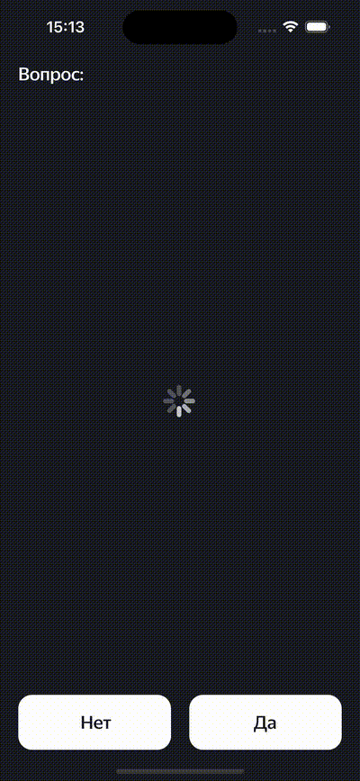

# MovieQuiz App

## Overview
A movie quize game

## Features
- Guess the rating of random movies
- Set highscores

## Tech Stack
- **Language:** Swift
- **Architecture:** MVP
- **Frameworks:** UIKit

## Installation
```bash
git clone https://github.com/BVladimir01/MovieQuiz.git
cd MovieQuiz
open MovieQuiz.xcodeproj
```

### Requirements
- Swift 5.x
- iOS 15+
- Xcode 16+

## Preview



##  Project Structure

**iOS-FakeNFT-Extended/** \
├ **App/** *Top level app files* \
├ **Extensions/** *Extensions for base frameworks* \
├ **Models/** *Global models* \
├ **Resources/** *Images, fonts* \
├ **Screens/** *Files for each screen* \
└ **Services/** *Services* \
**MovieQuizTests/** *Unit tests" \
**MovieQuizUITests/** *UI tests" \

## Future plan
- [ ] Add localization
- [ ] Add light/dark theme support
- [ ] Add documentation

## Acknowledgements
Big thanks to Yandex Practicum reviewers.
